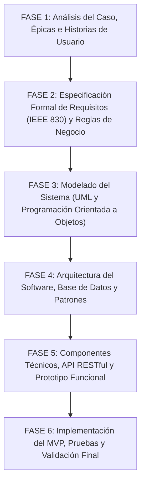

# CASO DE ESTUDIO Y GUÍA DE DESARROLLO DEL PROYECTO FORMATIVO
## SISTEMA DE GESTIÓN CLÍNICA Y BIENESTAR ANIMAL — VETCARE HUILA
### FICHA DE CARACTERIZACIÓN: 3239137 — ANÁLISIS Y DESARROLLO DE SOFTWARE (ADSO)

> **Institución:** Servicio Nacional de Aprendizaje (SENA)  
> **Centro de Formación:** Centro de la Industria, la Empresa y los Servicios (CIES) — Regional Huila  
> **Programa:** Tecnólogo en Análisis y Desarrollo de Software  
> **Proyecto Formativo:** 2417180 — "Desarrollo de Software Integrador de Tecnologías Orientadas a Servicios"  
> **Instructor:** Carlos Julio Cadena  
> **Equipo Responsable:** Grupo 7  
> **Documento:** Contexto del Cliente, Caso de Estudio y Hoja de Ruta de Fases hacia el MVP  
> **Fecha:** Octubre de 2026  

---

## 1. PRESENTACIÓN DEL PROYECTO Y OBJETIVO FORMATIVO

### 1.1 Propósito de la Actividad
El propósito de este proyecto formativo es que el equipo de aprendices asuma el rol de **analistas y desarrolladores de software**, aplicando el ciclo de vida de la ingeniería de software para concebir, diseñar, modelar, implementar y validar un **Producto Mínimo Viable (MVP)** funcional y robusto.

> [!IMPORTANT]
> **Instrucción Metodológica para el Equipo de Aprendices:**  
> A diferencia de ejercicios académicos donde los requisitos se entregan previamente tabulados y desglosados, en este proyecto se presenta el **contexto real y la narrativa de negocio del cliente**.  
> **Es responsabilidad exclusiva del equipo de aprendices leer minuciosamente el caso, analizar los testimonios y dinámicas de operación, y extraer por sí mismos:**
> 1. La totalidad de los **actores** que intervienen directa o indirectamente con el sistema.
> 2. Las **épicas** y el catálogo completo de **historias de usuario** con sus criterios de aceptación.
> 3. Los **requisitos funcionales (RF)**, **requisitos no funcionales (RNF)** y las **reglas de negocio (RN)** implícitas y explícitas.
> 4. Los artefactos de diseño, arquitectura, base de datos y código fuente que permitan materializar la solución.

---

## 2. CONTEXTO OPERACIONAL Y NARRATIVA DEL CLIENTE: CLÍNICA VETERINARIA "SAN ROQUE"

### 2.1 Reseña y Modelo Operativo
La Clínica Veterinaria y Centro de Bienestar Animal "San Roque", ubicada en la ciudad de Neiva (Huila), ofrece servicios integrales de atención médica para animales de compañía (principalmente caninos y felinos, con atención esporádica de otras especies menores). 

El establecimiento cuenta con recepción al público, consultorios de medicina general, sala de procedimientos y cirugía menor, área de toma de muestras de laboratorio, sala de vacunación y profilaxis, farmacia veterinaria y zona de estética canina y felina.

Pese al prestigio adquirido por la calidad humana y profesional de su equipo médico, la clínica atraviesa una crisis operativa producto del crecimiento acelerado de su demanda y la dependencia absoluta de registros manuales en cuadernos, hojas de cálculo dispersas en varias computadoras y comunicaciones telefónicas no centralizadas.

---

### 2.2 Entrevistas y Diagnóstico Operativo por Áreas

#### A. La Perspectiva de la Dirección General
> *"Llevamos más de diez años al servicio de la comunidad huilense, pero en el último año hemos perdido clientes y hemos tenido desacuerdos graves debido a la desorganización de la información. Mi gran preocupación es que no tenemos trazabilidad: si un veterinario atiende a un paciente hoy y prescribe un tratamiento, y la próxima semana el animal vuelve con complicaciones y lo atiende otro colega, muchas veces no hay cómo saber con exactitud qué se le suministró, qué dosis se le aplicó o si la mascota tenía antecedentes de alergia.*
> 
> *Por otra parte, necesito que el software sea seguro. No cualquiera puede entrar a modificar una historia médica ni a cambiar el inventario de la farmacia. Cada quien debe tener permisos según lo que hace: el personal de recepción debe encargarse del agendamiento y los datos del dueño; los médicos veterinarios deben tener acceso exclusivo a la historia clínica y a las prescripciones; y los dueños de las mascotas deberían poder consultar desde su celular el carné de vacunación y las fórmulas de sus animales sin tener que venir hasta acá a pedir copias físicas.*
> 
> *Nuestro objetivo inmediato es disponer de un MVP (Producto Mínimo Viable) que resuelva el corazón del problema: el registro confiable de clientes y pacientes, la agenda de citas médicas sin cruces de horarios, la historia clínica digital con registro de consultas y vacunas, y el control del inventario básico de medicamentos e insumos."*

---

#### B. La Realidad en la Recepción y Atención al Usuario
> *"El mostrador de recepción es un caos en las horas pico. Llega un señor con un perro enfermo en brazos, al mismo tiempo que suena el teléfono de una señora queriendo apartar cita, y entra otra persona preguntando si ya llegó el lote de vacunas contra la rabia. Actualmente anotamos todo en una libreta de citas y en un Excel.*
> 
> *Uno de nuestros dolores de cabeza más frecuentes es el registro de los clientes y sus mascotas. Muchas familias tienen más de un animal: vienen con dos perros y un gato, o adoptan una nueva mascota meses después. A veces escribimos el nombre del dueño con un error ortográfico en la cédula o en el apellido, y cuando vuelven terminamos creándole un segundo registro en el Excel. Necesitamos que el sistema nos obligue a buscar primero al propietario por su número de documento de identidad; si ya existe, simplemente le asociamos la nueva mascota; y si no existe, que nos permita registrar al dueño con sus datos completos de contacto (nombres, apellidos, cédula, teléfono, dirección y correo electrónico) y de inmediato ingresar los datos del animal.*
> 
> *De cada mascota es crucial capturar su nombre, su especie (si es perro, gato u otro), la raza, el sexo, una fecha de nacimiento exacta o estimada para calcular su edad actual, el color característico y, si lo tiene, el número de microchip. Varias veces nos ha pasado que llegan dos perros de raza criolla que se llaman igual y si no revisamos bien la identificación del dueño o el microchip, se corre el riesgo de confundir los expedientes.*
> 
> *El otro gran problema son las citas. La libreta de papel es un desastre: tachones, borrones, notas al margen. El doctor Carlos atiende consultas de 30 minutos, pero si dos recepcionistas atienden llamadas al mismo tiempo, terminamos agendando a dos personas a las 10:00 a.m. con el mismo doctor. Cuando los clientes llegan a la sala de espera y ven que hay choque de horarios, se molestan con justa razón. El sistema no debería permitir bajo ninguna circunstancia que se agende una cita con un veterinario en un horario que ya esté comprometido. Además, las citas deben poder pasar por distintos momentos: cuando la persona llama queda apartada; cuando el cliente llega a la clínica la confirmamos; cuando el doctor lo hace pasar entra a atención; y cuando termina la consulta debe quedar cerrada. Si alguien llama a cancelar o reprogramar, debe quedar registrado quién canceló y por qué motivo, y esa cancelación debe hacerse con al menos dos horas de anticipación para poder liberar el espacio a otro paciente."*

---

#### C. La Práctica Médica y la Consulta Veterinaria
> *"Nuestra mayor responsabilidad es la vida y la salud de los animales. En la consulta médica veterinaria los pacientes no hablan; el diagnóstico depende de la anamnesis que nos da el propietario, del examen físico minucioso y de los antecedentes clínicos.*
> 
> *Cuando un paciente entra al consultorio, lo primero que hacemos es el triaje y la toma de constantes vitales obligatorias: debemos pesar al animal en la báscula (el peso en kilogramos es crítico porque de él depende la dosificación exacta de cualquier fármaco), tomar la temperatura rectal en grados centígrados (que nos dice de inmediato si hay cuadro febril o hipotermia), auscultar la frecuencia cardíaca en latidos por minuto y evaluar la frecuencia respiratoria. Luego registramos el motivo de consulta según lo que relata el dueño, describimos los hallazgos del examen físico por sistemas (ojos, oídos, piel, mucosas, palpación abdominal) y emitimos un juicio diagnóstico.*
> 
> *Una vez emitido el diagnóstico, redactamos el plan terapéutico y la fórmula médica. Para evitar errores de medicación por letra ilegible, queremos que la fórmula se elabore en la computadora seleccionando los medicamentos directamente del catálogo de la clínica, indicando claramente la dosis, la frecuencia de administración y la duración en días del tratamiento, y que el dueño se la pueda llevar impresa o recibirla en su correo.*
> 
> *Aquí hay un punto legal y ético fundamental: la historia clínica es un documento médico-legal. Una vez que un veterinario termina la consulta y cierra el folio médico, esa entrada no puede ser borrada ni modificada por nadie. Si un médico se equivocó en un dato o requiere agregar información posterior a las 24 horas de la consulta, la única forma permitida debe ser mediante una nota aclaratoria o adenda que quede anexada al folio original con fecha, hora y firma del profesional. No podemos permitir que nadie altere diagnósticos pasados."*

---

#### D. La Sala de Vacunación, Profilaxis y Medicina Preventiva
> *"La medicina preventiva es la mitad de nuestro trabajo. Los cachorros y gatitos requieren un esquema de inmunización riguroso durante sus primeros meses de vida, y los adultos necesitan refuerzos anuales obligatorios (como la vacuna antirrábica y las polivalentes).*
> 
> *Tradicionalmente entregamos una cartilla o carné de cartulina donde pegamos el sticker de la vacuna y anotamos con lapicero. ¿Qué pasa? Los dueños pierden el carné, lo dejan refundido en un cajón, o se les olvida por completo cuándo le correspondía el siguiente refuerzo. Cuando la mascota finalmente enferma de parvovirus o moquillo, descubrimos que llevaba seis meses con la vacuna vencida.*
> 
> *El sistema debe llevar un carné de vacunación digital impecable. Cada vez que aplicamos una vacuna, debemos registrar el nombre comercial del biológico, el laboratorio fabricante, el número de lote del frasco (por si el laboratorio emite una alerta sanitaria), la fecha exacta de aplicación y la fecha en que vence o debe aplicarse el siguiente refuerzo. No se puede revacunar a un animal con la misma vacuna si no han pasado al menos 21 días desde la última dosis, porque inmunológicamente es contraproducente. Además, soñamos con que el sistema envíe una notificación o alerta automática al propietario cuando falten dos semanas para que venza una vacuna de su mascota."*

---

#### E. El Manejo de la Farmacia y el Inventario Clínico
> *"La farmacia veterinaria suministra tanto los medicamentos para la venta directa como los insumos que los veterinarios usan dentro de los consultorios y quirófanos (analgésicos, antibióticos, anestésicos, sueros, jeringas, vacunas).*
> 
> *Actualmente tenemos pérdidas económicas considerables porque no hay comunicación en tiempo real entre la consulta y el inventario. El doctor aplica un antibiótico en consulta, anota en un papelito 'se aplicó 1 ampolla de cefazolina', pero el papelito se pierde y nadie descuenta esa ampolla del inventario. Cuando vamos a buscarla para una emergencia el sábado en la tarde, el frasco está vacío.*
> 
> *Cada producto en la farmacia debe tener su código interno o código de barras, nombre genérico, presentación comercial, precio al público, cantidad actual en existencia y una cantidad mínima de seguridad. Si el stock de un antibiótico baja de 5 unidades, el sistema debe alertar inmediatamente en el panel administrativo que ese producto está en nivel crítico para que compras haga el pedido al distribuidor.*
> 
> *Adicionalmente, los medicamentos veterinarios tienen fechas de vencimiento estrictas. Si un lote de vacunas o antibióticos ya caducó, el sistema debe bloquear ese producto de manera automática para que ningún veterinario lo pueda formular ni suministrar por error. Y cuando en una consulta el veterinario indique que un medicamento fue administrado en la clínica, ese descuento del stock debe hacerse de manera automática e inmediata en la base de datos."*

---

#### F. La Experiencia del Propietario de la Mascota
> *"Como usuario de la clínica, me encanta el cariño con el que tratan a mi perrita 'Luna', pero el servicio administrativo es agotador. Cada vez que voy me preguntan de nuevo mi dirección y mi teléfono. Si el doctor me entrega una fórmula escrita a mano, en la farmacia de la esquina a veces no le entienden la letra y me da miedo darle una medicina equivocada.*
> 
> *Sería excelente poder ingresar desde mi celular o desde la página web de la clínica, ver el perfil de Luna, revisar cuáles vacunas tiene al día y cuándo le toca la próxima, y poder agendar una cita viendo los horarios libres del veterinario sin tener que llamar diez veces por teléfono. También me daría mucha tranquilidad poder descargar en PDF el historial de sus consultas o sus fórmulas médicas cada vez que lo necesite."*

---

## 3. HOJA DE RUTA Y FASES DEL PROYECTO HACIA LA ENTREGA DEL MVP

El equipo de aprendices deberá estructurar el proyecto cumpliendo rigurosamente con las **seis (6) fases oficiales del ciclo de desarrollo de software**:

---

### 3.1 Fase 1 — Análisis del Caso, Actores, Épicas e Historias de Usuario

#### Objetivos y Tareas del Aprendiz:
1. **Identificación y Caracterización de Actores:**
   - A partir de la narrativa y los diálogos del cliente, el equipo debe identificar **todos los actores** que participan en el ecosistema (tanto usuarios internos de la clínica como usuarios externos y procesos automatizados del sistema).
   - Para cada actor identificado, describir su rol, responsabilidades y permisos dentro del sistema.
2. **Definición de Épicas de Negocio:**
   - Descomponer la problemática general en grandes bloques de valor o **épicas**, que agrupen funcionalidades relacionadas (ej: gestión de pacientes, agenda de citas, historial médico, inventario, seguridad).
3. **Redacción de Historias de Usuario (HU):**
   - Extraer de la narrativa todas las necesidades de los usuarios y redactarlas bajo el formato ágil estándar:
     > *"Como [actor], quiero [funcionalidad / acción], para [beneficio / valor de negocio]."*
   - A cada historia de usuario se le deben redactar de manera obligatoria sus **Criterios de Aceptación** bajo la estructura formal **Given-When-Then (Dado - Cuando - Entonces)**.
   - Definir la estimación y la priorización de cada historia utilizando la técnica **MoSCoW (Must have, Should have, Could have, Won't have)** para delimitar cuáles integrarán estrictamente el **MVP**.

---

### 3.2 Fase 2 — Especificación Formal de Requerimientos y Reglas de Negocio

#### Objetivos y Tareas del Aprendiz:
1. **Requisitos Funcionales (RF):**
   - Formalizar cada requerimiento funcional que el sistema debe ejecutar, asignándole un identificador único, nombre claro, descripción no ambigua y prioridad.
   - Garantizar que los requisitos cubran de punta a punta las necesidades expresadas en los testimonios (registro atómico de propietarios y mascotas, cálculo dinámico de edad, búsqueda multicriterio, control de estados de citas, validación de constantes vitales, cierre de historias, emisión de recetas, carnés y control de inventario).
2. **Requisitos No Funcionales (RNF):**
   - Identificar y especificar los requisitos de calidad del sistema:
     * *Seguridad:* Cifrado de credenciales, autenticación por tokens, protección contra inyecciones SQL y accesos no autorizados.
     * *Rendimiento y Tiempo de Respuesta:* Tiempos de carga aceptables en consultas y transacciones concurrentes.
     * *Disponibilidad:* Garantía de operación continua durante la jornada clínica.
     * *Usabilidad y Diseño Adaptable:* Principios de diseño responsive (móvil y escritorio) y accesibilidad.
     * *Integridad y Portabilidad:* Mecanismos de borrado lógico (*soft delete*) y despliegue estandarizado en contenedores.
3. **Identificación de Reglas de Negocio (RN):**
   - Rastrear en el texto las políticas, restricciones y condiciones obligatorias de la clínica y redactarlas como reglas de negocio formales (ej: políticas de no solapamiento, plazos de inalterabilidad de historias, validaciones de edad vs fecha de nacimiento, control de stock mínimo, restricciones de medicamentos caducados e intervalos profilácticos).
4. **Matriz de Trazabilidad Inicial:**
   - Construir la matriz que relacione cada Historia de Usuario con sus correspondientes Requisitos Funcionales y Reglas de Negocio.

---

### 3.3 Fase 3 — Modelado del Sistema: UML y Diseño Orientado a Objetos

#### Objetivos y Tareas del Aprendiz:
1. **Diagrama de Casos de Uso:**
   - Representar gráficamente las interacciones entre los actores descubiertos y las funciones del sistema.
   - Aplicar con rigor la semántica de relaciones de inclusión (`<<include>>`) para pasos obligatorios y extensión (`<<extend>>`) para flujos opcionales o condicionales.
2. **Diagrama de Clases del Dominio:**
   - Diseñar la estructura de clases del sistema aplicando principios de la Programación Orientada a Objetos (Encapsulamiento, Abstracción, Herencia y Polimorfismo).
   - Incluir atributos con sus tipos de datos primitivos o compuestos, visibilidad (`+`, `-`, `#`), métodos con sus parámetros y retornos.
   - Modelar adecuadamente las relaciones: asociaciones simples, multiplicidades (`1`, `0..*`, `1..*`), agregaciones, composiciones y generalizaciones (herencia de usuarios/roles).
3. **Diagramas de Comportamiento Dinámico:**
   - **Diagramas de Secuencia:** Modelar el intercambio de mensajes temporal entre capas y objetos para los flujos más complejos del negocio:
     * El flujo de solicitud y validación de disponibilidad de una cita médica.
     * El flujo de atención de la consulta, registro de constantes vitales y afectación simultánea del inventario farmacéutico.
   - **Diagramas de Actividades o Estados:** Modelar el ciclo de vida de la cita médica (`PROGRAMADA` -> `CONFIRMADA` -> `EN_ATENCION` -> `FINALIZADA` / `CANCELADA`) y el flujo de decisión en la prescripción médica.

---

### 3.4 Fase 4 — Arquitectura de Software, Base de Datos y Patrones

#### Objetivos y Tareas del Aprendiz:
1. **Definición de la Arquitectura del Sistema:**
   - Documentar la arquitectura de software seleccionada (Arquitectura en Capas Desacoplada / MVC orientada a servicios RESTful).
   - Justificar la separación clara entre:
     * Capa de Presentación (Frontend Web / Móvil).
     * Capa de Controladores / Exposición de Servicios (API REST).
     * Capa de Lógica de Negocio y Servicios de Dominio.
     * Capa de Acceso a Datos y Persistencia (ORM / Repositorios).
     * Motor de Base de Datos Relacional.
2. **Diseño de Base de Datos Normalizada (3FN):**
   - Elaborar el Modelo Entidad-Relación (MER) y transformarlo al Modelo Relacional.
   - Demostrar que el diseño satisface la Primera, Segunda y Tercera Forma Normal (3FN), eliminando redundancias y anomalías de actualización.
   - Elaborar el Diccionario de Datos detallando tablas, columnas, tipos de datos, llaves primarias (PK), llaves foráneas (FK), índices y restricciones (`NOT NULL`, `UNIQUE`, `CHECK`).
3. **Script DDL de Base de Datos:**
   - Escribir el script SQL ANSI ejecutable (PostgreSQL o MySQL) que construya todas las tablas, relaciones, restricciones e índices necesarios para soportar el MVP.
4. **Patrones de Diseño de Software:**
   - Evidenciar la aplicación de patrones reconocidos de la industria: *Repository Pattern*, *Data Transfer Object (DTO)*, *Service Layer*, *Singleton* y controladores desacoplados.

---

### 3.5 Fase 5 — Componentes Técnicos, API RESTful y Prototipo Funcional

#### Objetivos y Tareas del Aprendiz:
1. **Catálogo de Endpoints de la API RESTful:**
   - Diseñar y documentar la especificación de la API bajo el estándar OpenAPI 3.0 / Swagger.
   - Definir los métodos HTTP apropiados (`GET`, `POST`, `PUT`, `PATCH`, `DELETE`), rutas, parámetros de cabecera y cuerpo en formato JSON, y códigos de estado HTTP estandarizados (`200 OK`, `201 Created`, `400 Bad Request`, `401 Unauthorized`, `403 Forbidden`, `404 Not Found`, `409 Conflict`).
2. **Mecanismo de Seguridad y Autenticación:**
   - Especificar e implementar la autenticación basada en tokens sin estado (JWT - JSON Web Tokens).
   - Implementar el control de acceso basado en roles (RBAC) para proteger los endpoints según los permisos de cada actor.
3. **Diseño de Interfaz de Usuario y Prototipo UX/UI:**
   - Diseñar la distribución visual (wireframes / maquetas interactivas) de las pantallas principales del MVP:
     * Inicio de sesión y panel de control (Dashboard).
     * Ficha de registro y consulta de propietarios y mascotas.
     * Calendario interactivo de agenda de citas.
     * Estación de trabajo del médico veterinario para consulta e historia clínica.
     * Módulo de consulta de carné de vacunas y catálogo de farmacia.
4. **Contenerización y Despliegue Local:**
   - Elaborar los archivos de configuración (`Dockerfile` y `docker-compose.yml`) que permitan levantar de forma automática e integrada la base de datos, el backend y el frontend con un solo comando.

---

### 3.6 Fase 6 — Implementación del MVP, Pruebas y Validación Final

#### Objetivos y Tareas del Aprendiz:
1. **Construcción y Versionamiento del Código Fuente:**
   - Desarrollar el código en los repositorios correspondientes siguiendo buenas prácticas de codificación limpia (Clean Code), modularidad y manejo de excepciones centralizado.
   - Gestionar el trabajo colaborativo en Git aplicando flujo de ramas (`main`, `develop`, `feature/*`), con commits atómicos y mensajes descriptivos.
2. **Plan y Ejecución de Pruebas de Software (QA):**
   - Diseñar la matriz de casos de prueba que valide tanto los caminos felices (*happy paths*) como los escenarios de error y validación de reglas de negocio (ej: documentos duplicados, colisión de horarios, medicamentos vencidos, historias cerradas).
   - Implementar pruebas unitarias en la capa de servicios con frameworks de pruebas (JUnit / Mockito en Java, o xUnit en .NET, o Jest en Node).
   - Ejecutar pruebas de integración de los endpoints de la API (mediante Postman / Newman o herramientas de testing automatizado).
3. **Documentación Técnica Post-Código:**
   - Entregar los manuales finales exigidos por el Proyecto Formativo:
     * **Manual Técnico:** Arquitectura, dependencias, variables de entorno, diccionario de endpoints y diagramas actualizados.
     * **Manual de Instalación:** Pasos exactos para clonar, configurar variables `.env`, ejecutar migraciones y levantar el entorno local con Docker.
     * **Manual de Usuario:** Guía ilustrada con capturas de pantalla de la aplicación real explicando cómo operar cada función del MVP.
4. **Matriz de Trazabilidad Completa y Criterios de Aceptación del MVP:**
   - Consolidar la matriz de trazabilidad de extremo a extremo que evidencie que cada necesidad detectada en la Fase 1 cuenta con su respectivo requisito, clase, tabla, endpoint, interfaz y prueba automatizada.

---

## 4. CRITERIOS DE EVALUACIÓN Y DEFINICIÓN DE TERMINADO (DoD)

Para que el proyecto del Grupo 7 sea aprobado satisfactoriamente en las revisiones del instructor, deberá superar la siguiente lista de verificación:

- [ ] **Coherencia y Trazabilidad:** Los artefactos de código y base de datos responden exactamente a las necesidades planteadas en la narrativa del negocio.
- [ ] **Autonomía Analítica:** El equipo extrajo y justificó por sí mismo los actores, historias, requisitos y reglas de negocio sin limitarse a una transcripción superficial.
- [ ] **Persistencia y Calidad de Datos:** La base de datos se encuentra normalizada en 3FN, no permite registros huérfanos ni duplicados, y valida la integridad referencial.
- [ ] **Flujo del MVP Operativo:** Es posible ejecutar en vivo el ciclo completo:
  1. *Registro:* Crear un propietario y registrar su mascota.
  2. *Agenda:* Reservar una cita validando que no haya choque de horario con el veterinario.
  3. *Atención Médica:* Atender la cita, registrar signos vitales y diagnóstico en la historia clínica.
  4. *Prescripción y Stock:* Prescribir un medicamento y verificar que el inventario se descuente de manera atómica.
  5. *Vacunación:* Registrar una vacuna y comprobar que el carné digital y la fecha de refuerzo queden asentados.
- [ ] **Repositorio Git Organizado:** Evidencia de commits frecuentes, participación equitativa de todos los integrantes del equipo y cumplimiento de la estructura de carpetas estándar establecida para la Ficha 3239137.
